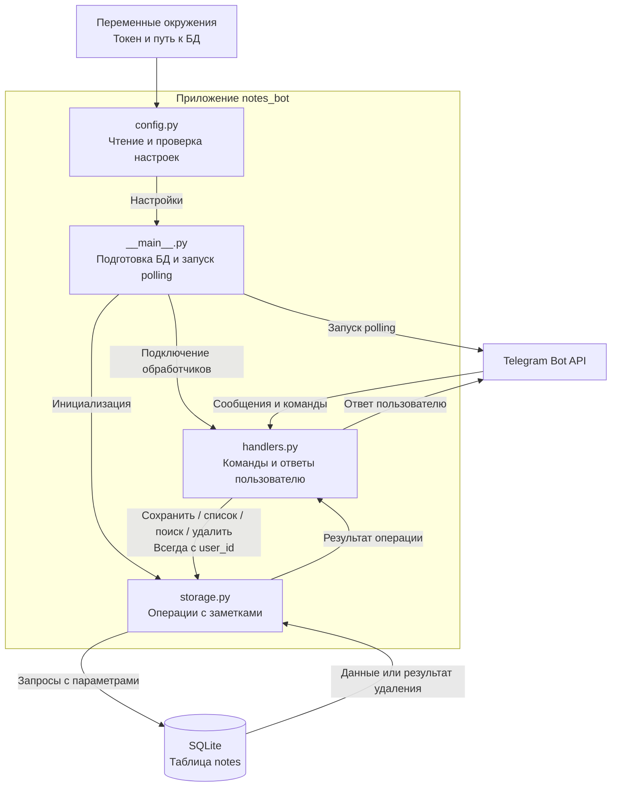

# Архитектура NotesBot

Схема описывает целевую архитектуру MVP. Состояние реализации модулей —
в [progress.md](progress.md).

`handlers.py` отвечает за Telegram-интерфейс, `storage.py` — за данные и ограничение доступа по владельцу. `__main__.py` связывает модули и управляет запуском.

Хранилище тестируется с временной SQLite-БД, обработчики — без обращения к Telegram.
